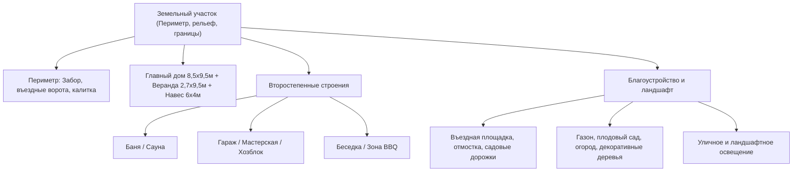

# ПАСПОРТ АРХИТЕКТУРНОГО ПРОЕКТА «WISHOV»
**Жилой дом с пристроенной верандой, навесом и благоустройством участка**  
*Местоположение: агрогородок Вишов, Могилёвская область, Республика Беларусь*

---

## 1. Общие сведения об объекте

| Параметр | Значение |
| :--- | :--- |
| **Наименование проекта** | Индивидуальный жилой дом с верандой и генпланом участка |
| **Кодовое имя воркспейса** | `Wishov` |
| **Статус проекта** | Основной объём дома и веранды согласован (3D CAD + фотореализм); подготовка к моделированию генплана всего участка |
| **Габариты основного дома** | $8,50 \times 9,50\text{ м}$ (пятно застройки $80,75\text{ м}^2$) |
| **Габариты пристройки (веранды)** | $2,70 \times 9,50\text{ м}$ (пятно застройки $25,65\text{ м}^2$) |
| **Общее пятно застройки дома с верандой** | $11,20 \times 9,50\text{ м}$ ($106,4\text{ м}^2$) |
| **Навес для автомобиля** | $6,00 \times 4,00\text{ м}$ ($24,0\text{ м}^2$) вдоль фасада |
| **Отступ от дороги** | $7,00\text{ м}$ |

---

## 2. Экспликация помещений и зон пристройки ($2,70 \times 9,50\text{ м}$)

| № | Зона / Помещение | Габариты (Ш × Д) | Площадь | Назначение и оснащение |
| :---: | :--- | :---: | :---: | :--- |
| **1** | **Парадное открытое крыльцо** | $2,70 \times 4,20\text{ м}$ | $11,34\text{ м}^2$ | Входная зона со стороны дороги: брус 150×150 мм, ограждение, дощатый настил, ступени к мощёной дорожке парковки. |
| **2** | **Прихожая (тёплый тамбур-шлюз)** | $2,70 \times 2,20\text{ м}$ | $5,94\text{ м}^2$ | Полноразмерный гардероб 1,40 м (6 крючков, полка, банкетка), обувница, энергоэффективная буферная зона. Глухая стена со двора. |
| **3** | **Гостиная / Лаунж-зона** | $2,70 \times 3,10\text{ м}$ | $8,37\text{ м}^2$ | Центральное окно 1,10 м со двора, сплошная стена 2,00 м под большой диван, TV или камин; панорамный выход в сад. |
| **4** | **Крытая терраса выхода в сад** | $2,70 \times 2,20\text{ м}$ | $5,94\text{ м}^2$ | Открытая летняя зона отдыха с навесом (металлочерепица), стойками 150×150 мм, горизонтальными рейками и спуском на газон. |

---

## 3. Конструктивные решения и материалы

### 3.1. Кровля и стропильная система
* **Тип сопряжения**: Честная Т-образная врезка двух двускатных кровель (основной дом + веранда).
* **Высота коньков**: Конёк веранды поднят на отметку **$+5,80\text{ м}$ строго вровень с коньком основного дома**.
* **Ендовы**: Две идеально ровные диагональные линии ендовы (передняя и задняя) с желобами в тёмно-графитовом цвете. Никаких паразитных переломов и ступеней.
* **Покрытие**: Металлочерепица / кликфальц цвета «тёмный графит» (**RAL 7016**).
* **Навес для авто**: Односкатная деревянная стропильная система с уклоном от стены дома ($+2,85\text{ м}$) к въезду ($+2,25\text{ м}$).

### 3.2. Стены и наружная отделка
* **Основной объём стен**: Светло-серая минеральная штукатурка / блоки (**RAL 7035**).
* **Цоколь**: Облицовка тёмным клинкерным кирпичом высотой $40\text{ см}$.
* **Угловая рустовка (Quoin Stones)**: Клинкерные рустовые камни на всех внешних углах дома и веранды (чередование $42\text{ см}$ и $22\text{ см}$, шаг $24,5\text{ см}$) в цвет металлочерепицы.
* **Центральный фасадный акцент**:
  * Окно $1,10\text{ м}$ в вертикальном пилоне из графитового клинкера от цоколя до карниза.
  * Декоративное настенное панно из вертикальных реек термодерева с архитектурным двухсторонним бра (Up & Down beam).
* **Окна**: Белоснежный многокамерный профиль ПВХ с энергосберегающими стеклопакетами. Все 4 окна основного дома ($150 \times 150\text{ см}$) оформлены подоконными клинкерными отливами.

### 3.3. Навес на 1 автомобиль ($6,00 \times 4,00\text{ м}$)
* **Расположение**: Вдоль главного фасада дома ($X = 1,8\dots7,8\text{ м}$), глубина в сторону дороги $4,0\text{ м}$ ($Z = 0,1\dots4,1\text{ м}$).
* **Парковка**: 1 автомобиль (кроссовер), расположенный **параллельно дороге** (боком вдоль дома).
* **Пролёт**: Широкий въездной пролёт $5,7\text{ м}$ между опорными столбами из бруса $150 \times 150\text{ мм}$ с подкосами $45^\circ$.
* **Пешеходная связь**: Мощёная брусчаткой дорожка от парковочной площадки к ступеням открытого крыльца.

---

## 4. Состав утверждённых визуальных материалов проекта

| Файл | Описание | Формат / Разрешение |
| :--- | :--- | :---: |
| [`veranda_3d_viewer.html`](./veranda_3d_viewer.html) | Интерактивная 3D-модель (Three.js) с переключением вариантов отделки, ракурсов, конька и навеса | HTML5 / WebGL |
| [`gallery.html`](./gallery.html) | Презентационная адаптивная фотогалерея экстерьера со слайдером | HTML5 / CSS3 / JS |
| [`cursor_perspective_carport_1car.jpg`](./cursor_perspective_carport_1car.jpg) | Фотореалистичный рендер: Перспектива с дороги с навесом 6×4м и машиной параллельно дороге | 16:9 / 8K Ultra-HD |
| [`cursor_perspective_white_render.jpg`](./cursor_perspective_white_render.jpg) | Фотореалистичный рендер: Перспектива с дороги дома и веранды без навеса | 16:9 / 8K Ultra-HD |
| [`cursor_yard_facade_true_v4.jpg`](./cursor_yard_facade_true_v4.jpg) | Фотореалистичный рендер: Честный фасад со двора (крыльцо слева, терраса в сад справа, 3D-глубина крыши дома) | 16:9 / 8K Ultra-HD |
| [`cursor_yard_facade_warm_clinker_render.jpg`](./cursor_yard_facade_warm_clinker_render.jpg) | Фотореалистичный рендер: Альтернативная отделка со двора (тёплый обожжённый клинкер) | 16:9 / 8K Ultra-HD |
| [`cursor_garden_white_render.jpg`](./cursor_garden_white_render.jpg) | Фотореалистичный рендер: Вид со стороны сада (4 окна 150×150 см, терраса в сад) | 16:9 / 8K Ultra-HD |
| [`mode_c_true_yard_cad.png`](./mode_c_true_yard_cad.png) | 3D CAD: Точная чертёжная проекция фасада со двора с обеими террасами | 16:9 PNG |
| [`mode_c_carport_1car_cad.png`](./mode_c_carport_1car_cad.png) | 3D CAD: Перспектива навеса 6×4м с автомобилем | 16:9 PNG |
| [`mode_c_fixed_garden.png`](./mode_c_fixed_garden.png) | 3D CAD: Угол сада с крытой террасой | 16:9 PNG |
| [`mode_c_fixed_roof_check.png`](./mode_c_fixed_roof_check.png) | 3D CAD: Контроль Т-врезки скатов кровли сверху | 16:9 PNG |
| [`mode_c_top_plan.png`](./mode_c_top_plan.png) | 3D CAD: План планировки в разрезе сверху | 16:9 PNG |

---

## 5. Программа расширения: 3D-Генплан всего земельного участка

Следующим этапом выполняется расширение 3D-модели до **полноценного цифрового двойника всего участка**:

### Данные, ожидаемые от Заказчика:
1. Схематичный план участка сверху (от руки или чертёж) с привязкой строений и отступами.
2. Фотографии остальных существующих или планируемых построек (баня, сарай, гараж, забор).
3. Пожелания по зонированию (сад, огород, зона отдыха, парковка).
