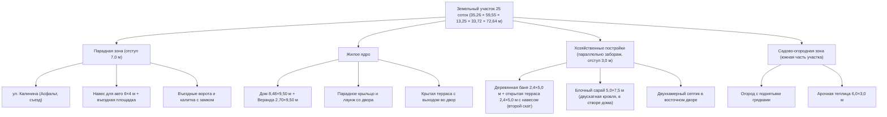

# ПАСПОРТ АРХИТЕКТУРНОГО ПРОЕКТА «WISHOV»
**Жилой дом с пристроенной верандой, навесом и благоустройством участка**  
*Местоположение: агрогородок Вишов, Могилёвская область, Республика Беларусь*

---

## 1. Общие сведения об объекте

| Параметр | Значение |
| :--- | :--- |
| **Наименование проекта** | Индивидуальный жилой дом с верандой и генпланом участка |
| **Кодовое имя воркспейса** | `Wishov` |
| **Статус проекта** | Основной объём дома и веранды согласован (3D CAD + фотореализм); подготовка к моделированию генплана всего участка |
| **Габариты основного дома** | $8,50 \times 9,50\text{ м}$ (пятно застройки $80,75\text{ м}^2$) |
| **Габариты пристройки (веранды)** | $2,70 \times 9,50\text{ м}$ (пятно застройки $25,65\text{ м}^2$) |
| **Общее пятно застройки дома с верандой** | $11,20 \times 9,50\text{ м}$ ($106,4\text{ м}^2$) |
| **Навес для автомобиля** | $6,00 \times 4,00\text{ м}$ ($24,0\text{ м}^2$) вдоль фасада |
| **Отступ от дороги** | $7,00\text{ м}$ |

---

## 2. Экспликация помещений и зон пристройки ($2,70 \times 9,50\text{ м}$)

| № | Зона / Помещение | Габариты (Ш × Д) | Площадь | Назначение и оснащение |
| :---: | :--- | :---: | :---: | :--- |
| **1** | **Парадное открытое крыльцо** | $2,70 \times 4,20\text{ м}$ | $11,34\text{ м}^2$ | Входная зона со стороны дороги: брус 150×150 мм, ограждение, дощатый настил, ступени к мощёной дорожке парковки. |
| **2** | **Прихожая (тёплый тамбур-шлюз)** | $2,70 \times 2,20\text{ м}$ | $5,94\text{ м}^2$ | Полноразмерный гардероб 1,40 м (6 крючков, полка, банкетка), обувница, энергоэффективная буферная зона. Глухая стена со двора. |
| **3** | **Гостиная / Лаунж-зона** | $2,70 \times 3,10\text{ м}$ | $8,37\text{ м}^2$ | Центральное окно 1,10 м со двора, сплошная стена 2,00 м под большой диван, TV или камин; панорамный выход в сад. |
| **4** | **Крытая терраса выхода в сад** | $2,70 \times 2,20\text{ м}$ | $5,94\text{ м}^2$ | Открытая летняя зона отдыха с навесом (металлочерепица), стойками 150×150 мм, горизонтальными рейками и спуском на газон. |

---

## 3. Конструктивные решения и материалы

### 3.1. Кровля и стропильная система
* **Тип сопряжения**: Честная Т-образная врезка двух двускатных кровель (основной дом + веранда).
* **Высота коньков**: Конёк веранды поднят на отметку **$+5,80\text{ м}$ строго вровень с коньком основного дома**.
* **Ендовы**: Две идеально ровные диагональные линии ендовы (передняя и задняя) с желобами в тёмно-графитовом цвете. Никаких паразитных переломов и ступеней.
* **Покрытие**: Металлочерепица / кликфальц цвета «тёмный графит» (**RAL 7016**).
* **Навес для авто**: Односкатная деревянная стропильная система с уклоном от стены дома ($+2,85\text{ м}$) к въезду ($+2,25\text{ м}$).

### 3.2. Стены и наружная отделка
* **Основной объём стен**: Светло-серая минеральная штукатурка / блоки (**RAL 7035**).
* **Цоколь**: Облицовка тёмным клинкерным кирпичом высотой $40\text{ см}$.
* **Угловая рустовка (Quoin Stones)**: Клинкерные рустовые камни на всех внешних углах дома и веранды (чередование $42\text{ см}$ и $22\text{ см}$, шаг $24,5\text{ см}$) в цвет металлочерепицы.
* **Центральный фасадный акцент**:
  * Окно $1,10\text{ м}$ в вертикальном пилоне из графитового клинкера от цоколя до карниза.
  * Декоративное настенное панно из вертикальных реек термодерева с архитектурным двухсторонним бра (Up & Down beam).
* **Окна**: Белоснежный многокамерный профиль ПВХ с энергосберегающими стеклопакетами. Все 4 окна основного дома ($150 \times 150\text{ см}$) оформлены подоконными клинкерными отливами.

### 3.3. Навес на 1 автомобиль ($6,00 \times 4,00\text{ м}$)
* **Расположение**: Вдоль главного фасада дома ($X = 1,8\dots7,8\text{ м}$), глубина в сторону дороги $4,0\text{ м}$ ($Z = 0,1\dots4,1\text{ м}$).
* **Парковка**: 1 автомобиль (кроссовер), расположенный **параллельно дороге** (боком вдоль дома).
* **Пролёт**: Широкий въездной пролёт $5,7\text{ м}$ между опорными столбами из бруса $150 \times 150\text{ мм}$ с подкосами $45^\circ$.
* **Пешеходная связь**: Мощёная брусчаткой дорожка от парковочной площадки к ступеням открытого крыльца.

---

## 4. Состав утверждённых визуальных материалов проекта

| Файл | Описание | Формат / Разрешение |
| :--- | :--- | :---: |
| [`veranda_3d_viewer.html`](./veranda_3d_viewer.html) | Интерактивная 3D-модель (Three.js) с переключением вариантов отделки, ракурсов, конька и навеса | HTML5 / WebGL |
| [`gallery.html`](./gallery.html) | Презентационная адаптивная фотогалерея экстерьера со слайдером | HTML5 / CSS3 / JS |
| [`cursor_perspective_carport_1car.jpg`](./cursor_perspective_carport_1car.jpg) | Фотореалистичный рендер: Перспектива с дороги с навесом 6×4м и машиной параллельно дороге | 16:9 / 8K Ultra-HD |
| [`cursor_perspective_white_render.jpg`](./cursor_perspective_white_render.jpg) | Фотореалистичный рендер: Перспектива с дороги дома и веранды без навеса | 16:9 / 8K Ultra-HD |
| [`cursor_yard_facade_true_v4.jpg`](./cursor_yard_facade_true_v4.jpg) | Фотореалистичный рендер: Честный фасад со двора (крыльцо слева, терраса в сад справа, 3D-глубина крыши дома) | 16:9 / 8K Ultra-HD |
| [`cursor_yard_facade_warm_clinker_render.jpg`](./cursor_yard_facade_warm_clinker_render.jpg) | Фотореалистичный рендер: Альтернативная отделка со двора (тёплый обожжённый клинкер) | 16:9 / 8K Ultra-HD |
| [`cursor_garden_white_render.jpg`](./cursor_garden_white_render.jpg) | Фотореалистичный рендер: Вид со стороны сада (4 окна 150×150 см, терраса в сад) | 16:9 / 8K Ultra-HD |
| [`mode_c_true_yard_cad.png`](./mode_c_true_yard_cad.png) | 3D CAD: Точная чертёжная проекция фасада со двора с обеими террасами | 16:9 PNG |
| [`mode_c_carport_1car_cad.png`](./mode_c_carport_1car_cad.png) | 3D CAD: Перспектива навеса 6×4м с автомобилем | 16:9 PNG |
| [`mode_c_fixed_garden.png`](./mode_c_fixed_garden.png) | 3D CAD: Угол сада с крытой террасой | 16:9 PNG |
| [`mode_c_fixed_roof_check.png`](./mode_c_fixed_roof_check.png) | 3D CAD: Контроль Т-врезки скатов кровли сверху | 16:9 PNG |
| [`mode_c_top_plan.png`](./mode_c_top_plan.png) | 3D CAD: План планировки в разрезе сверху | 16:9 PNG |

---

## 5. Кадастровые данные и инженерно-геодезические параметры участка

На основании Свидетельства о госрегистрации № 701/1912-2069 от 10.02.2022 г., Землеустроительного дела и топографической съёмки М 1:500 (УКПП «Проект-сервис», заказ № 6156/23):

| Параметр | Значение по официальным документам |
| :--- | :--- |
| **Кадастровый номер** | `720480501101000392` |
| **Адрес объекта** | Республика Беларусь, Могилёвская обл., Белыничский р-н, Вишовский с/с, аг. Вишов, ул. Калинина, д. 26 |
| **Целевое назначение** | Для строительства и обслуживания одноквартирного жилого дома |
| **Площадь участка** | **$0,2500\text{ га}$ ($25,0\text{ соток}$ / $2500\text{ м}^2$)** |
| **Правообладатель** | Мурашко Сергей Владимирович (частная собственность) |
| **Обременения и зоны** | Охранная зона электрических сетей (код 5.2), площадь $0,0035\text{ га}$ ($35\text{ м}^2$) в северо-западном углу участка |
| **Абсолютные отметки рельефа** | $193,14\dots193,52\text{ м}$ (на дороге ул. Калинина $193,86\text{ м}$). Перепад высот по участку составляет всего $0,38\text{ м}$ на длине $72\text{ м}$ — практически ровное плато с мягким естественным уклоном в сторону сада |

### 5.1. Ведомость поворотных точек и границ земельного участка

* **1 – 2**: $35,26\text{ м}$ — парадный фасад вдоль ул. Калинина (въездная группа, забор, калитка, навес).
* **2 – 3**: $59,55\text{ м}$ — восточная (правая) граница с соседним участком.
* **3 – 4**: $13,25\text{ м}$ — внутренний уступ границы.
* **4 – 5**: $33,72\text{ м}$ — южная (задняя) межа (граница огорода/сада).
* **5 – 1**: $72,64\text{ м}$ — западная (левая) протяжённая граница участка.

### 5.2. Посадка дома на местности и придорожная инфраструктура

По материалам изысканий, топографической съёмке и фотофиксации (Google Street View):
1. **Посадка дома относительно границ участка**:
   * Дом смещён к **западной (левой) меже**: расстояние от левого забора до стены дома составляет **$7,00\text{ м}$** (свободный проезд авто и проход в сад вдоль западного фасада).
   * Справа от дома (со стороны двора) открывается широкий солнечный массив участка шириной **$17,08\text{ м}$** от стены пристроенной веранды до правой межи, куда выходит терраса, парадная въездная группа, зона отдыха/BBQ и сад.
   * Отступ фасада дома от линии забора по ул. Калинина: **$7,00\text{ м}$**.
2. **Придорожная полоса ул. Калинина**:
   * Проезжая часть (асфальт) идёт под уклоном $\approx -1,6^\circ$ к линии забора:
     * Слева (у западного угла) ширина зелёной полосы от забора до асфальта: **$3,50\text{ м}$**;
     * Справа (у восточного угла) ширина зелёной полосы: **$2,50\text{ м}$**.
   * **Трасса ЛЭП**: железобетонные опоры и провода проходят **строго параллельно проезжей части на расстоянии ровно $1,00\text{ м}$ от края асфальта** по зелёной газонной обочине.
     * На территории участка по факту установлена **всего одна опора ЛЭП** ($X = 17,70\text{ м}, Z \approx 8,80\text{ м}$), расположенная ровно на **$50\text{ см}$ левее** первого смотрового люка канализации.
     * На опоре смонтирован металлический шкаф учёта электроэнергии (ВРУ / щиток со счётчиком) и защитная труба кабельного спуска.
     * Соседние опоры уличной сети находятся за границами участка с пролётом ~35–40 м.
   * **Охранная зона ЛЭП**: охранная зона электросетей ($35\text{ м}^2$, код 5.2) расположена у северо-западного угла на зелёной полосе и прилегающей части участка.
3. **Водоотведение и канализация (Септик)**:
   * Фактический двухкамерный септик расположен в восточном дворе ($X \approx 18,3\dots19,6\text{ м}, Z \approx 4,0\text{ м}$) на удалении $\approx 7\text{ м}$ от веранды.
   * Оснащён бетонными горловинами и бирюзово-синими полимерными смотровыми люками (в точности как зафиксировано на фотопанорамах).
   * Площадка перед домом (под навесом для автомобиля) полностью свободна от люков.
4. **Водоснабжение и газоснабжение**:
   * Магистральный водопровод по ул. Калинина, индивидуальный подземный ввод в дом трубой **В-25пэ** (полиэтилен 25 мм) непосредственно в коридор/санузел.
   * Распределительный подземный газопровод среднего давления **Г-32пэ с.д.** вдоль ул. Калинина. (Для визуальной чистоты и фотореализма 3D-сцены условные пунктирные линии коммуникаций скрыты).
5. **Архитектурная четверть окон**:
   * Все оконные блоки ($1,50 \times 1,50\text{ м}$) заглублены в четверть на **$14\text{ см}$** от наружной плоскости блоков с формированием массивных блочных откосов и тонкого наклонного металлического отлива с капельником ($2,5\text{ см}$).
   * Чердачное окно во фронтоне утоплено внутрь кладки на $10\text{ см}$ (без выступающих накладных элементов).

---

## 6. Экспликация помещений существующего дома (БТИ) и баланс площадей

По результатам обследования БТИ (инвентарное дело, литер «А1/бл» — одноэтажный блочный жилой дом):

| № | Назначение помещения | Размеры (Д × Ш) | Площадь по БТИ | Интеграция с проектом веранды |
| :---: | :--- | :---: | :---: | :--- |
| **1** | **Коридор (прихожая дома)** | $5,75 \times 3,80\text{ м}$ ($h=3,09\text{ м}$) | $16,7\text{ м}^2$ | **Главный вход в дом**. Сюда выходит дверной проём со двора, который теперь защищён пристроенной верандой и шлюзом-тамбуром. |
| **2** | **Санузел** | $2,60 \times 1,81\text{ м}$ | $4,7\text{ м}^2$ | Мокрая зона дома, примыкает к коридору и точке ввода водопровода В-25пэ. |
| **3** | **Кухня** | $3,83 \times 3,17\text{ м}$ | $12,1\text{ м}^2$ | Окно выходит на западный фасад. |
| **4** | **Жилая комната 1 (Гостиная)** | $5,57 \times 3,83\text{ м}$ | $20,4\text{ м}^2$ | Окна на север (ул. Калинина) и запад. |
| **5** | **Жилая комната 2 (Спальня)** | $3,80 \times 2,98\text{ м}$ | $11,3\text{ м}^2$ | Окно на север (ул. Калинина). |
| — | **Итого жилой дом (существующий)** | **Наружные стены $8,48 \times 9,50\text{ м}$** | **$65,2\text{ м}^2$** | Базовый объём дома. |
| + | **Проектируемая пристройка веранды** | **Наружные стены $2,70 \times 9,50\text{ м}$** | **$+25,65\text{ м}^2$** | Тамбур ($5,9\text{ м}^2$), лаунж ($8,4\text{ м}^2$), 2 террасы ($17,3\text{ м}^2$). |
| **∑** | **ОБЩИЙ ИТОГ (Дом + Веранда)** | **Пятно застройки $11,18 \times 9,50\text{ м}$** | **$90,85\text{ м}^2$** | Комплексный жилой дом нового стандарта. |

---

## 7. Программа реализации: 3D-Генплан всего земельного участка (25 соток)

### 7.1. Ведомость строений и сооружений генерального плана

| № | Объект | Размеры (Ш × Д) | Площадь застройки | Конструктивное исполнение | Привязка на местности |
| :---: | :--- | :---: | :---: | :--- | :--- |
| **1** | **Жилой дом с верандой** | $11,18 \times 9,50\text{ м}$ | $90,85\text{ м}^2$ | Блоки / минеральная штукатурка, цоколь из клинкера, кровля Т-образная RAL 7016 | Отступ от дороги $7,00\text{ м}$, от левого забора $7,00\text{ м}$, широкий восточный двор $17,08\text{ м}$ |
| **2** | **Навес для автомобиля** | $6,00 \times 4,00\text{ м}$ | $24,00\text{ м}^2$ | Деревянные стойки 150×150 мм, стропильная система с уклоном | Вдоль главного фасада дома ($X = 1,8\dots7,8\text{ м}$) |
| **3** | **Баня с открытой террасой** | Баня $2,40 \times 5,00\text{ м}$ + терраса $2,40 \times 5,00\text{ м}$ (всего $4,80 \times 5,00\text{ м}$) | $24,00\text{ м}^2$ ($12,0\text{ м}^2$ баня + $12,0\text{ м}^2$ терраса на плите) | Деревянный янтарно-коричневый брус, монолитная бетонная плита, разноскатная кровля RAL 7016 (один скат к забору, второй скат-навес над террасой на деревянных стойках), белое ПВХ остекление | Параллельно левому забору с отступом ровно **$3,00\text{ м}$**, на расстоянии **$6,00\text{ м}$** от задней стены дома ($Z = -15,50\dots-20,50\text{ м}$) |
| **4** | **Хозяйственный сарай** | $5,00 \times 7,50\text{ м}$ | $37,50\text{ м}^2$ | Блоки в стилистике дома, двускатная кровля RAL 7016 (конёк +3,95 м), распашные ворота | Параллельно правому забору с отступом ровно **$3,00\text{ м}$**, начинается строго в створе задней стены дома ($Z = -9,50\dots-17,00\text{ м}$) |
| **5** | **Септик (канализация)** | $4,20 \times 3,20\text{ м}$ | — | 2 бетонных колодца с бирюзовыми полимерными люками, деревянный поддон | В восточном дворе ($X \approx 18,2\dots19,6\text{ м}, Z \approx 4,0\text{ м}$) |
| **6** | **ЛЭП 0,4 кВ** | 1 опора на участке | — | Железобетонная опора с щитом учёта ВРУ и ввода | На зелёной обочине ($X = 17,70\text{ м}, Z = 8,80\text{ м}$) на 50 см левее люка септика |
